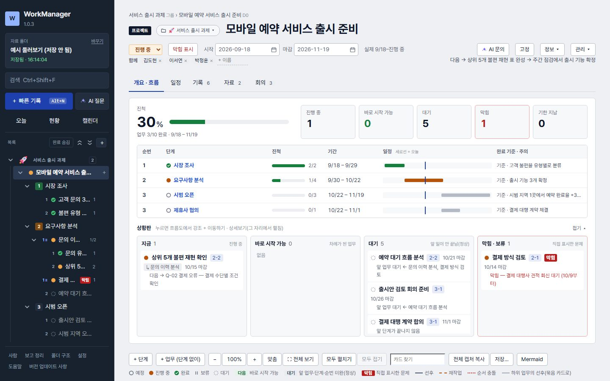

# WorkManager

흐름으로 업무를 관리하고, 쌓인 기록을 AI로 요약·정리하는 Windows 개인 업무 관리 앱입니다.

**최신 버전: 1.1.3** · Windows (x64)

| 필요한 것 | 바로가기 |
|---|---|
| 프로그램 | [WorkManager.exe 다운로드](https://github.com/1821rpm/workmanager/releases/latest/download/WorkManager.exe) |
| 사용 설명서 | **[GitHub에서 바로 읽기](manual/README.md)** |
| 오프라인 설명서 | [Releases](https://github.com/1821rpm/workmanager/releases/latest)의 [WorkManager-Manual-1.1.3.html](https://github.com/1821rpm/workmanager/releases/download/v1.1.3/WorkManager-Manual-1.1.3.html) — 받은 파일을 더블클릭하면 브라우저에서 열립니다 |
| 변경 내용 · 이전 버전 | [Releases](https://github.com/1821rpm/workmanager/releases) |



자료 형식 v6를 유지하며 기존 자료 폴더와 AI 연결 설정을 이어 사용합니다.

## 1.1.3에서 달라진 점

- 백업이 실패해도 종료·업데이트를 계속하며 다음 실행에 실패 경로와 작업을 알립니다.
- 읽기·쓰기 접근 오류에 짧은 재시도를 추가하고, 동시 복사 수를 기본 4개로 낮췄습니다. 설정에서 1~8개로 바꿀 수 있습니다.
- 일부 파일이 빠진 백업은 「완성되지 않은 백업」으로 보존합니다. 설정 › 백업에서 진단을 확인하고 해당 폴더만 정리합니다.
- 같은 내용을 다시 저장하거나 AI 한눈 요약만 바뀌면 종료 백업을 건너뜁니다. 지문이 없거나 읽지 못하면 새 백업이 필요한 이유를 표시합니다.
- 완성 이름 충돌을 피하고 이름 변경의 일시 오류를 최대 60초 동안 재시도합니다.

구판에서 종료 백업에 이미 막혔다면 새 EXE를 별도로 받아 교체해야 할 수 있습니다. 실제 보안 프로그램 환경에서는 추가 확인이 필요합니다.

## 1.1.2에서 달라진 점

- **휴지통 전체 비우기가 되지 않던 것**을 고쳤습니다. 지우는 업무에 붙은 회의가 갈 곳이 없으면 확인창이 그 회의 이름과 어느 업무에 붙어 있는지 보여 주고, 그 자리에서 「이 회의도 같이 지우기」 또는 「미분류로 옮기기」를 고릅니다.
- **마감을 지운 일이 「기한 지남」으로 뜨던 것**을 고쳤습니다. 기한은 적어 둔 마감만 보고, 시작일을 마감 대신 쓰지 않습니다(현황 할 일·단계·프로젝트 묶음·흐름도 모두).
- **고치지 않았는데 「AI 요약 다시」가 뜨던 것**을 고쳤습니다. 바뀐 기록을 세는 기준을 자료 폴더에 담아 다른 PC에서도 같은 기준을 쓰고, AI 자신이 쓴 것은 「바뀜」으로 세지 않습니다.
- 현황을 짧게: 우선순위 3줄 · 일정 5줄까지만 펼치고, 「챙길 것」은 제목과 개수만 두고 접습니다. 우선순위의 업무 이름을 누르면 그 업무로 갑니다.
- 왼쪽 위 로고를 누르면 **AI 상태 창** — 지금 무엇을 만들고 있고 무엇을 기다리는지 어느 화면에서든 봅니다.
- 배경 AI 요약 동시 수 기본값 3 → 5(설정에서 1~5).
- 정리 칸 안내를 줄이고, AI 요약의 성격·진행·예정을 굵게 했습니다. 자료·링크를 넣을 때 이름도 함께 쓸 수 있습니다.
- Ctrl+Enter는 어디서나 「지금 쓰던 것을 완료」입니다. 되돌릴 수 없는 확인창에서는 돌지 않습니다.

## 알려진 점

- 설명서 그림은 이번 판에서 다시 찍었습니다 — 앱 안 도움말 그림과 글꼴이 미세하게 다를 수 있습니다.
- 배경 AI 요약을 동시에 5개까지 보냅니다. 연결한 AI 서버가 느려지면 설정에서 1~4로 내리세요.

## 할 수 있는 일

- **업무 흐름**: 그룹 › 프로젝트 › 단계 › 업무로 나누고, 순번·병렬·선후 관계로 지금 할 일과 막힌 일을 한눈에 봅니다.
- **기록**: 날짜별 진행 이력과 계속 다듬는 정리를 글·표·사진·코드로 남깁니다. 엑셀 표를 서식 그대로 붙여 넣을 수 있습니다.
- **일정과 회의**: 오늘 할 일, 캘린더, 간트, 반복 회의와 회의록의 후속 조치를 연결합니다.
- **AI 요약과 보고**: 직접 연결한 AI로 AI 요약·일/주/월 보고·질문을 실행합니다. AI 요약은 단추 본체로 바로 실행하고 ▾에서 보낼 글을 확인합니다.
- **내 PC에 보관**: 고른 폴더에 기록을 파일(JSON·첨부)로 보관하고, 백업·휴지통·Excel 내보내기를 씁니다.

## 처음 사용하기

1. `WorkManager.exe`를 내려받아 보관할 폴더에 두고 실행합니다. 설치 과정은 없습니다.
   - Microsoft Edge WebView2 Runtime이 필요합니다. Windows 11에는 기본으로 들어 있습니다.
   - 서명되지 않은 실행 파일이라 Windows가 경고(SmartScreen)를 띄울 수 있습니다. 아래 「내려받은 파일 확인」으로 파일이 맞는지 확인한 뒤 **추가 정보 › 실행**을 누르세요.
2. **튜토리얼 보기**에서 별도 빈 연습 폴더를 고르세요. 완성 예시를 참고하고 「직접 따라 하기」 프로젝트에 입력하며 연습할 수 있습니다. 내용과 진행 표시는 그 폴더에 저장됩니다.
3. 직접 쓰려면 **새 자료 폴더 만들기**로 빈 폴더를 고릅니다. 그다음부터는 자동으로 저장됩니다.
4. **설정 › 백업**에서 자료 폴더와 다른 곳에 백업 폴더를 정해 두세요.

창의 **X**에서 창 닫기(트레이) 또는 프로그램 종료를 고릅니다. 설정 › 시작 · 알림에서 선택을 바꿀 수 있습니다. 트레이에 둔 동안 알림과 AI 갱신이 계속됩니다. 완전 종료하면 다음 7일·최대 50개 알림을 Windows에 맡깁니다. 이후 다른 PC에서 바꾼 내용은 반영되지 않고 PC가 꺼진 시간에는 울리지 않습니다. 표시된 알림을 Windows 이력에서 지우면 다음 실행 때 놓친 알림이 다시 뜰 수 있습니다.

## AI 기능

AI 기능은 쓰는 사람이 직접 연결해야 켜집니다(**설정 › AI 연결**). OpenAI 호환 API나 회사 안의 LLM 서버를 등록할 수 있고, 여러 개를 등록해 골라 쓸 수 있습니다. 연결하지 않아도 기록·흐름·일정 기능은 모두 쓸 수 있습니다.

- AI 연결이 있으면 앱을 켤 때와 화면을 열 때 바뀐 정리·요약을 등록한 주소로 전송합니다. 일하는 중에는 지금 화면만 편집 완료 또는 마지막 변경 뒤 1분 후 갱신합니다. 자동 요청은 합산해 기본 제한 없음이며 **설정 › 시작 · 알림**에서 끄거나 20·50·100회 한도를 정할 수 있습니다(실패·중단 포함).
- AI 요약·보고는 보내기 전에 보낼 글 전문을 확인할 수 있습니다.
- **AI에게 묻기**는 고른 글·이 업무·이 프로젝트·전체·일반 범위를 고릅니다. 답 아래 보낸 기록에서 근거를 확인할 수 있습니다.
- 범위를 바꿔도 지금 대화는 이어지며 다음 질문부터 새 범위를 적용합니다. 이전 대화는 이력에서 다시 열 수 있습니다.
- API 키는 이 PC의 앱 설정에만 저장되고 자료 폴더에는 들어가지 않습니다. 업데이트 후에도 기존 연결을 이어 씁니다.
- AI 답에는 의미 오류와 누락이 남을 수 있습니다. 정정 표시·이유·원문과 근거 기록을 확인하세요.

## 업데이트

1.0.8부터는 설정 › 업데이트 › 지금 확인에서 바뀐 점을 읽고 받은 뒤 「지금 다시 시작」 또는 「끌 때 바꾸기」를 고릅니다. 1.0.11·1.0.12·1.0.13에서 정식 1.1.0으로 직접 업데이트하는 경로를 확인했습니다. 직접 교체하려면 아래 순서를 따르세요.

1. 트레이에서 **완전히 종료**합니다.
2. 새 `WorkManager.exe`로 바꿔 넣고 실행합니다.
3. 자료 폴더와 설정은 그대로 이어집니다.

## 내려받은 파일 확인

각 Release의 `SHA256.txt`와 내려받은 파일의 해시가 같은지 확인할 수 있습니다(PowerShell).

```powershell
Get-FileHash .\WorkManager.exe -Algorithm SHA256
```

## 알아 둘 것

- Windows 전용입니다. 자료량의 상한은 정해 두지 않았습니다.
- 회사 PC의 보안 프로그램(문서 보안·프록시 등)에 따라 동작이 다를 수 있습니다.
- 이 저장소에는 배포 파일과 안내만 있고, 소스 코드는 공개하지 않습니다.
- 문제나 제안은 [Issues](https://github.com/1821rpm/workmanager/issues)에 남겨 주세요.
