# WorkManager 1.0.8 사용 설명서

흐름으로 업무를 관리하고, AI로 요약·정리합니다.

[프로그램 다운로드](https://github.com/1821rpm/workmanager/releases/download/v1.0.8/WorkManager.exe) · [HTML 설명서 다운로드](https://github.com/1821rpm/workmanager/releases/download/v1.0.8/WorkManager-Manual-1.0.8.html) · [프로젝트 첫 화면](../README.md)

앱의 **도움말**에서도 같은 내용을 볼 수 있습니다. 그림은 1.0.8 예시 화면을 Windows Edge에서 촬영했습니다. 업데이트 그림의 1.0.9는 안내 예시입니다.

## 목차

- [시작하기](#start)
- [업무 구조 세우기](#structure)
- [흐름으로 관리하기](#flow)
- [기록하기 — 이력과 정리](#record)
- [일정 · 현황 · 회의](#schedule)
- [AI로 요약 · 정리하기](#ai)
- [보고 · 내보내기](#report)
- [사람 · 틀 · 백업 · 설정](#manage)
- [단축키](#keys)

## 사용 흐름

1. **흐름** — 그룹 › 프로젝트 › 단계 › 업무 › 하위 업무로 나누고, 순번·병렬·선후로 순서를 세운다
2. **기록** — 그날 한 일은 이력에, 정리된 생각은 정리에 — 이력에서 정리로 옮겨 다듬는다
3. **AI** — 쌓인 이력·회의로 정리·브리핑·보고를 만들고 원문과 비교한다

## 1. 시작하기

자료를 둘 폴더를 한 번만 정하면 그다음부터 저장 버튼이 없습니다.

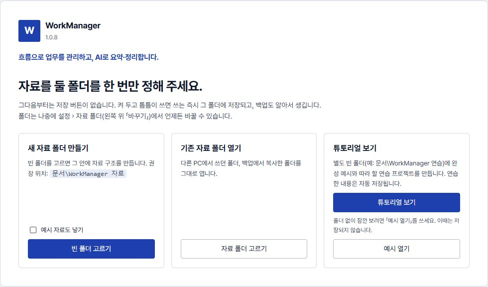

### 자료 폴더

- 「새 자료 폴더 만들기」로 빈 폴더를 고르면 그 안에 자료 구조를 만듭니다. 권장 위치는 `문서\WorkManager 자료`입니다.
- 쓰는 즉시 자동 저장되고(입력을 멈추면 저장 + 최대 간격마다 강제 저장 + 창을 바꿀 때 바로 저장), 백업 폴더를 정하면 백업도 알아서 생깁니다.
- 모든 기록은 사람이 읽을 수 있는 JSON 파일입니다. 폴더째 복사하면 다른 PC에서도 그대로 열립니다.

### 튜토리얼: 보고 참고하거나 직접 따라 하기

- 「튜토리얼 보기」에서 업무 자료와 별도의 빈 폴더(예: 문서\WorkManager 연습)를 고르세요. 기존 자료가 있는 폴더에는 예시를 넣지 않습니다.
- 「완성 예시 둘러보기」로 작성된 흐름(단계 4개 · 묶음 업무와 하위 업무 · 단계를 넘는 화살표)·이력·정리·회의를 참고하고, 「연습 프로젝트 열기」로 직접 써 보세요. 다섯 단계(흐름 읽기 → 내 흐름 만들기 → 기록과 할 일 → 회의와 캘린더 → 현황과 AI 요약)를 마칠 때마다 직접 체크하면 다음에 열어도 이어집니다.
- 원래 업무로 돌아가려면 「업무 폴더로 돌아가기」 또는 자료 폴더의 「바꾸기」에서 기존 업무 폴더를 고르세요. 연습 자료도 그대로 남습니다.

### 자료 폴더 바꾸기

- 왼쪽 위 「자료 폴더」 카드의 **바꾸기** 또는 **설정 › 자료 폴더**에서 바꿉니다. 지금 쓰는 폴더의 전체 경로도 여기서 보입니다.
- 「기존 자료 폴더 고르기…」 = 다른 PC·백업에서 가져온 폴더를 엽니다. 「빈 폴더 고르기…」 = 새로 시작합니다.
- 바꿔도 이전 폴더의 자료는 지우지 않습니다. 지금 자료를 다른 곳으로 옮기려면 앱을 완전히 끈 뒤 폴더째 복사하고, 복사한 폴더를 고르세요.

### 항상 켜 두기

- 창의 X는 트레이로 숨깁니다. 완전히 끄려면 트레이 아이콘 메뉴의 「완전히 종료」를 누릅니다(저장 → 종료 백업 → 닫기 순서가 화면에 보입니다).
- 설정 › 시작 · 알림에서 Windows 시작 때 자동 실행, 어디서든 빠른 기록 단축키, 퇴근 전·마감 알림을 켤 수 있습니다.

### 새 버전 업데이트 (1.0.8)

- 켤 때와 6시간마다 공개 Release(github.com/1821rpm/workmanager)를 확인해 새 판이 나오면 오른쪽 아래에 알림이 뜹니다 — 「바뀐 점 보기」 「업데이트 받기」 「나중에」 「이 버전 건너뛰기」. 업무 기록은 보내지 않습니다.
- 「업데이트 받기」는 새 EXE를 지금 EXE 옆에 받고 Release의 SHA256과 맞춰 봅니다. 그다음 **지금 다시 시작**(저장 → 종료 백업 → EXE 바꾸기 → 새 판으로 다시 열기) 또는 **끌 때 바꾸기**(트레이 「완전히 종료」 때 바꾸고 다음에 켜면 새 판)를 고릅니다. 바꾼 뒤 예전 EXE(`WorkManager.이전.exe`)는 새 판이 정상으로 켜지면 지웁니다.
- 회사 프록시가 github.com을 막거나 EXE 폴더에 쓸 수 없으면 이유와 「Release 페이지 열기」가 보입니다 — 거기서 WorkManager.exe를 받아 완전히 종료한 뒤 바꿔 넣으세요. 설정 › 업데이트에서 자동 확인을 끄거나 「지금 확인」을 누를 수 있습니다.

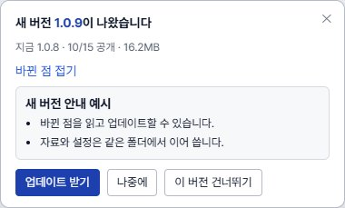

## 2. 업무 구조 세우기

큰 일은 위에서 아래로 나누고, 왼쪽 목록에서 끌어서 정리합니다.

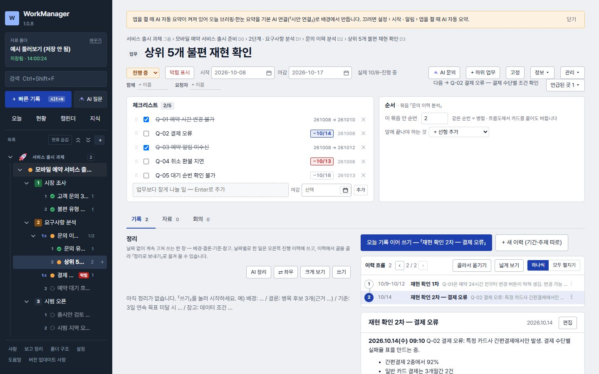

### 다섯 층

- **그룹** — 프로젝트를 묶는 폴더(예: 서비스 출시 과제 🚀). 이모지를 붙일 수 있습니다.
- **프로젝트** › **단계** › **업무** › **하위 업무** — 업무가 커지면 하위 업무로 쪼갭니다. 하위 업무가 있는 업무를 「묶음 업무」라고 부릅니다.
- **체크리스트** — 업무보다 잘게 나눈 일. 추가한 날과 체크한 날이 자동으로 붙고, 왼쪽 손잡이(⠿)를 끌어 순서를 바꿉니다(키보드 Alt+↑/↓). 마감을 넣으면 캘린더·현황·오늘 브리핑에 뜹니다. 날짜를 눌러 고치고, 며칠 걸리는 일이면 「기간으로」를 눌러 시작일을 더하면 캘린더에 막대로 보입니다(기본은 날짜 하나). 이력·하위 흐름까지 필요하면 「하위 업무로 올리기」.
- **일상 업무** — 프로젝트에 넣기 애매한 갑작스러운 이슈·데이터 요청. 요청자와 마감을 적어 할 일처럼 씁니다. 커지면 프로젝트로 끌어 옮깁니다.

### 왼쪽 목록

- 줄을 끌어 위치를 바꿉니다: 줄 위쪽 = 그 앞, 아래쪽 = 그 뒤, 가운데 = 그 안.
- 줄 오른쪽 ＋로 그 아래에 단계·업무·하위 업무를, 목록 머리의 ＋로 새 프로젝트·그룹·업무를 만듭니다.
- 목록 머리의 **완료 숨김**을 켜면 하위까지 다 끝난 항목을 숨깁니다. 지금 고른 항목의 줄기는 남고, 맨 아래 「보이기」로 되돌립니다.
- 번호(1, 2 …)는 흐름 순번, ∥는 병렬, 흐린 줄은 앞 일을 기다리는 업무입니다. 자주 여는 항목은 「고정」으로 맨 위에 둡니다.

### 왼쪽 목록 순서

- 프로젝트·단계·묶음 업무 아래는 흐름도의 수행 순번대로 보입니다. 같은 순번의 병렬 업무는 직접 정한 목록 순서를 유지합니다.
- 흐름도·관리에서 순번을 바꾸면 왼쪽 목록도 바뀝니다. 목록에서 다른 순번 묶음으로 끌거나 관리의 위/아래를 누르면 수행 순번도 함께 바뀝니다.

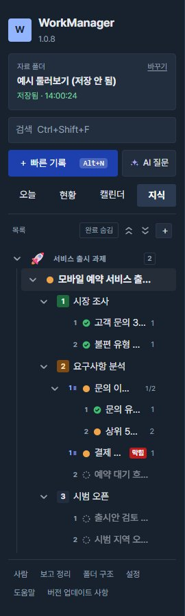

## 3. 흐름으로 관리하기

무엇이 먼저고 무엇이 동시에 가는지를 세워 두면, 지금 할 일과 막힌 일이 저절로 보입니다.

### 순서를 세우는 세 가지

- **단계 순번** — 1 → 2 → 3. 같은 번호의 단계는 병렬로 갑니다(예시: 3단계 「시범 오픈」 ∥ 「제휴사 협의」).
- **업무 순번** — 단계 안에서 같은 번호면 병렬(예시: 「문의 이력 분석」 ∥ 「결제 방식 검토」), 다음 번호는 앞 번호가 끝나야 시작.
- **선후 화살표** — 업무 화면의 「앞에 끝나야 하는 것」 또는 흐름도에서 카드 ●을 끌어 다른 카드에 놓아 잇습니다. 다른 단계의 업무와도 이을 수 있습니다.

### 상황판

- **지금** = 진행 중, **바로 시작 가능** = 차례가 된 업무, **대기** = 앞 일이 아직 안 끝남(정상), **막힘** = 직접 표시한 문제(자료 미수신, 회신 대기 등).
- 막힘은 업무 머리의 「막힘 표시」로 이유와 함께 적습니다. 대기와 달리 내가 풀어야 할 문제라 오늘 화면·현황에도 따로 모입니다.
- 카드를 누르면 흐름도에서 강조되고, 메뉴에서 이동·미리보기·그 자리에서 하위 흐름 펼치기를 고릅니다.

### 흐름도 다루기

- 카드를 끌어 순번을 바꾸고, 「전체 보기」로 창 가득 봅니다. 「전체 캡처 복사」는 PPT에 바로 붙일 그림으로, 「Mermaid」는 글로 내보냅니다.
- **그룹 화면**에서는 프로젝트끼리의 흐름(예시: 모바일 예약 서비스 출시 준비 → 전국 확대 오픈)과 묶인 프로젝트 현황을 한 화면에서 봅니다.

### 체크와 자동 목록

- 본문에 넣은 체크박스는 읽기 화면에서도 바로 체크·해제할 수 있고 자동 저장됩니다. 글을 바꾸려면 편집을 여세요.
- 자동 목록으로 바뀐 뒤에도 목록 안에 커서를 두면 **그대로 쓰기**가 나타납니다. 글을 더 썼거나 편집을 다시 열어도 기호와 내용을 일반 글자로 바꿀 수 있습니다.

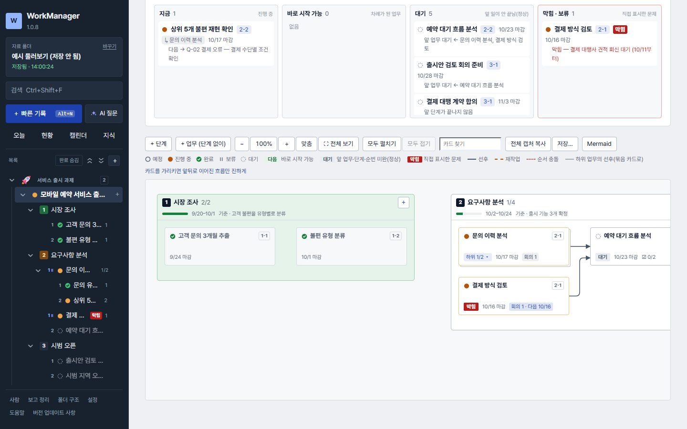

## 4. 기록하기 — 이력과 정리

날짜별로 한 일은 이력에, 날짜 없이 계속 고쳐 쓰는 결론은 정리에 둡니다.

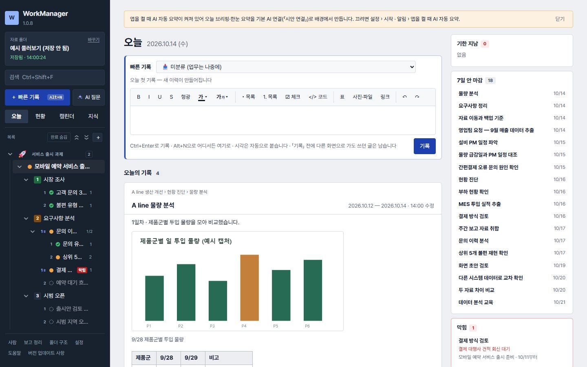

### 이력

- 「오늘 기록 쓰기」를 누르면 오늘 이력을 열고, 편집을 처음 열 때 `2026.10.07(수) 09:10` 같은 날짜 도장이 한 번 찍힙니다. 같은 날 다시 열면 아래에 이어 씁니다.
- 어디서든 **Alt+N**(빠른 기록)으로 적고, 업무를 고르지 않으면 「미분류」에 모였다가 나중에 옮깁니다.
- 글·표·사진을 붙여 넣을 수 있습니다. 엑셀·PPT·워드 표는 색과 구조를 유지하고, 코드 블록은 SQL·Python 등 언어별 색과 접기, Mermaid는 그림으로 볼 수 있습니다.
- `[[`를 치면 다른 업무를 이어 붙입니다. 이어진 업무 쪽에는 「언급된 곳」으로 거꾸로 보입니다.

### 정리

- 이력에서 글을 고르고 「정리로 보내기」를 누르면 글·표·사진이 인용으로 옮겨지고, 끝의 「(10/4 기록)」을 누르면 원래 이력으로 돌아갑니다.
- 정리는 배경·결론·기준처럼 오래 남길 것을 한 장으로 고쳐 씁니다. 「크게 보기」와 「좌우」로 이력과 나란히 봅니다.
- 이력이 많아지면 「이력 흐름」 목록에서 순서를 끌어 바꾸고, 갈래가 생기면 「골라서 옮기기」로 다른 업무나 새 하위 업무로 나눕니다.
- 엑셀·파워포인트 텍스트 상자 안 글자를 복사해 붙여 넣으면 글로 들어갑니다(1.0.8). 그림으로 넣고 싶으면 옆에 뜨는 「그림으로 바꾸기」.

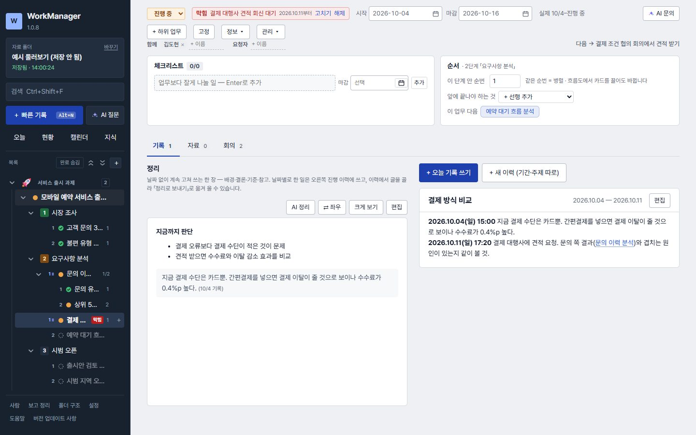

## 5. 일정 · 현황 · 회의

마감과 회의를 한곳에서 보고, 회의에서 나온 일은 바로 업무로 보냅니다.

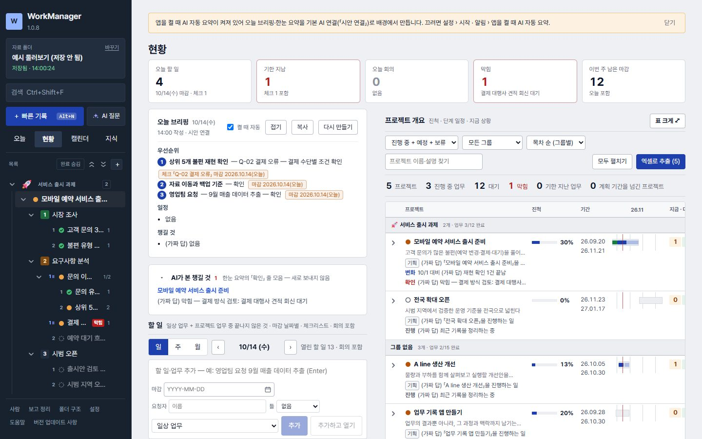

### 현황

- 맨 위 요약 칸에서 오늘 할 일·기한 지남·오늘 회의·막힘·이번 주 남은 마감을 한눈에 보고, 칸을 누르면 그 목록이나 항목으로 갑니다.
- 「오늘 브리핑」을 누르면 AI가 오늘 기준 후보(기한 지남·마감·체크리스트·막힘·진행 중)와 회의로 우선순위·일정·챙길 것을 정리합니다. 그날 하루 이 PC에 남습니다. 앱을 켤 때(자정을 넘길 때도) 배경에서 미리 만들어 둡니다(기본 켜짐, 「켤 때 자동」으로 끔) — 만드는 중이면 반짝이는 별로 보입니다.
- 할 일 칸에서 바로 일상 업무를 추가하고(마감·요청자), 체크하면 완료됩니다. 마감이 있는 체크리스트 항목도 그날 묶음에 「체크」로 뜹니다. 기본은 「일」 보기입니다.
- 프로젝트 개요는 표 크게 보기·찾기·정렬이 되고, 「엑셀로 추출」로 목록·단계·이력·회의·선후·자료를 시트별로 받습니다.

### 캘린더

- 주 시작은 일요일입니다. 날짜를 눌러 그날 마감 업무·할 일·회의를 바로 넣습니다.
- 막대·진행 이력·회의·체크리스트를 끌어 다른 날로 옮기고, 막대 양 끝을 끌면 시작일·끝나는 날이 바뀝니다. 끄는 동안 새 날짜가 커서 옆에 보입니다.
- 프로젝트의 **일정** 탭 캘린더는 단계마다 색이 다르고, 업무 막대 앞 번호가 「단계-순번」(2-1, 하위 업무는 2-1-2)입니다. 위 범례를 누르면 그 단계만 진하게 보이고 나머지는 흐려집니다. 전체 캘린더의 범례는 프로젝트별입니다.
- 간트에서는 막대를 끌어 일정을 옮깁니다(기간 길이는 그대로).

### 회의

- 프로젝트·업무의 「회의」 탭에서 만듭니다. 매주·격주·매월 반복을 정하면 캘린더에 회차가 나타나고, 회차를 열어 그날 회의록을 씁니다.
- 회의록의 **결정**과 **후속 조치**를 나눠 적고, 후속 조치는 「보내기」로 새 업무·체크리스트·다음 할 일로 넘깁니다(예시: 지난 「출시 준비 주간 점검」 회차).
- 각 회의의 **AI 정리**는 내용·결정·후속 조치를 읽고 결과를 먼저 보여 줍니다. 「회의록 맨 위에 넣기」로 AI 구역만 바꾸며 직접 쓴 내용은 보존합니다.
- 회의 탭의 **회의 전체 AI 정리**는 현재 업무·프로젝트와 하위 업무에 연결된 회의를 모읍니다. 결과는 「정리 기록으로 저장」으로 해당 업무·프로젝트의 기록 탭에 새로 남깁니다. 반복 안건 틀과 작성된 회차는 구분합니다.

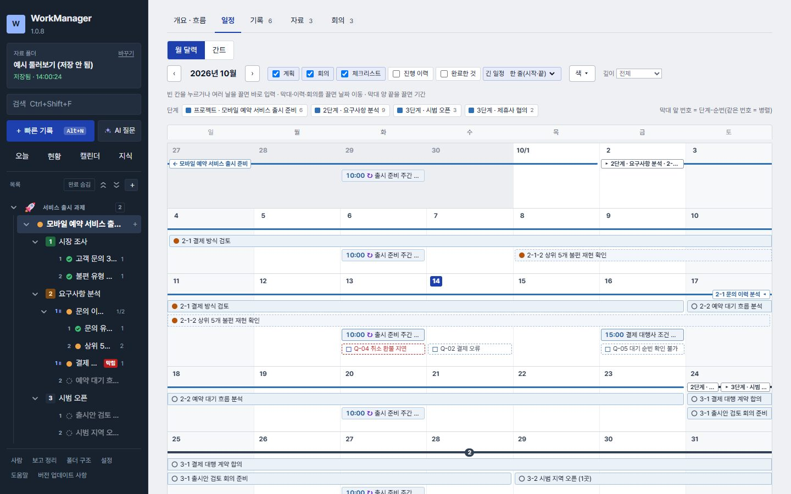

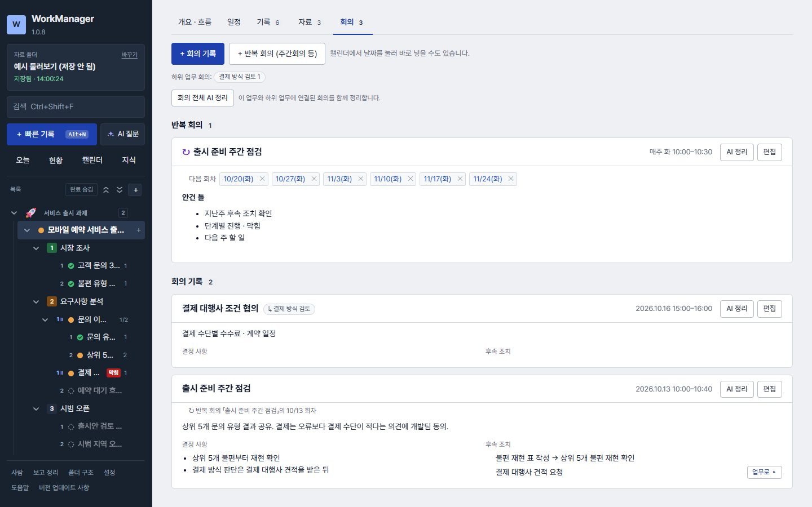

## 6. AI로 요약 · 정리하기

AI 연결이 있으면 오늘 브리핑과 한눈 요약을 자동으로 만듭니다(기본 켜짐, 하루 합계 5개). 설정에서 끌 수 있으며, 수동 정리·보고는 보내기 전에 보낼 글 전체를 확인합니다.

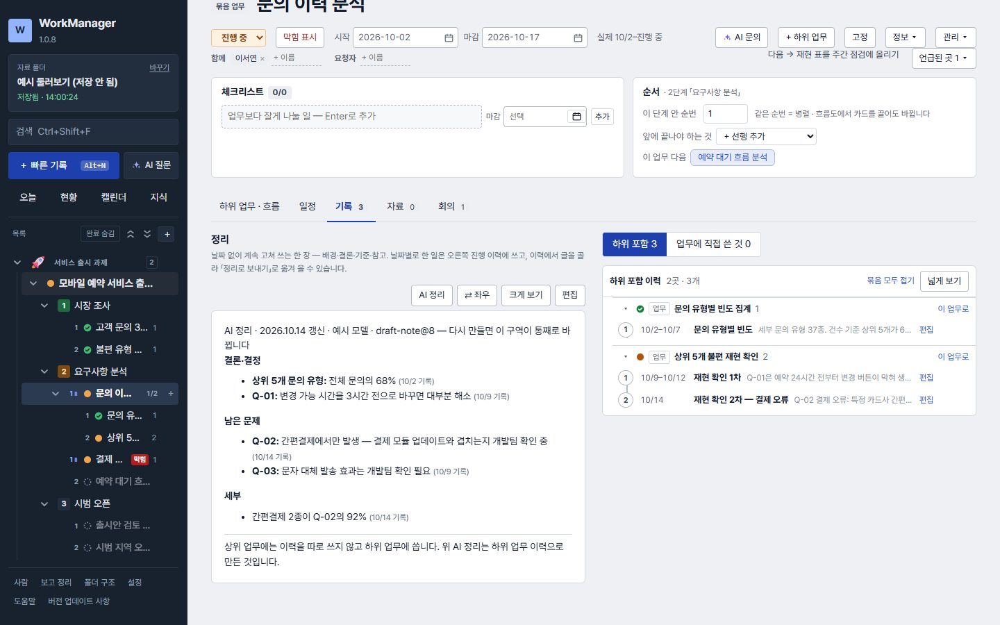

### AI 연결

- **설정 › AI 연결**에서 LLM(OpenAI 호환 또는 직접 형식 — 회사 안 LLM이나 외부 서비스)을 하나 이상 등록하고 기본을 고릅니다. 키는 Windows 앱 안에만 저장되고 자료 폴더에는 들어가지 않습니다.
- AI 정리·AI 브리핑·회의 AI 정리 창의 **이번 추가 요청**에 더할 관점을 적을 수 있습니다(예: 「다른 팀 협의가 필요한 것 위주로」). 보낸 요청은 그 업무(회의)에 기억되어 다음에 열면 미리 들어가 있고, 언제 넣은 요청인지 함께 보입니다. 「기억 지우기」를 누르거나 비우고 보내면 다음부터 넣지 않습니다. 지시문의 형식 규칙은 그대로 지켜지며, 기억은 이 PC에만 있습니다.
- 연결이 둘 이상이면 AI 창의 「AI 연결」에서 이번에 쓸 연결을 바꿔 보낼 수 있고, 지시문은 기본을 그대로 쓰거나 업무마다 고쳐 둘 수 있습니다(그 업무와 하위 업무에 적용).

### 무엇을 요약해 주나

- **AI 정리**(업무 정리 칸) — 이력과 연결된 회의 내용·결정·후속 조치를 함께 읽고 결론·결정 / 남은 문제 / 세부로 정리 맨 위에 둡니다. 다시 누르면 그 구역만 통째로 새로 바뀌고, 직접 쓴 정리는 그대로입니다. 상위 업무는 하위 업무의 이력과 회의까지 묶어 정리합니다. 이력이 없어도 회의가 있으면 정리할 수 있습니다.
- **AI 브리핑**(프로젝트·단계 기록 탭) — 진척·기한·막힘·대기를 앱이 계산해 함께 보내 상태 · 부족한 것 · 중요 포인트를 받습니다.
- **한눈 요약**(프로젝트·단계·묶음 업무의 개요 · 흐름 맨 위) — 이 일이 어떤 일인지(분류)·어디까지 왔는지·다음에 무엇이 오는지를 서너 줄로 받습니다. 목적·현재 상황·하위 업무 상태·다가오는 2주·최근 기록(하위 포함)·정리를 보냅니다. 기록이 거의 없으면 보내지 않고 「목적 한 줄」 칸을 보여 주며, 제목만으로 짐작한 성격에는 「(추정)」이 붙습니다.
- **켤 때 자동**(설정 › 시작 · 알림, 또는 오늘 브리핑·한눈 요약 칸) — 앱을 켤 때와 자정을 넘길 때 오늘 브리핑과 진행 중 프로젝트 한눈 요약을 배경에서 하나씩 만듭니다. 자동 요청 합계는 기본 하루 5개이며 설정에서 개수를 고릅니다(실패·중단도 포함, 수동 만들기는 별도). 지금 연 화면이 한도 안에서 먼저이고, 같은 날 같은 기록이면 다시 보내지 않습니다. 기본은 켜짐이고 AI 연결이 없으면 보내지 않습니다. 처음 보낼 때 한 번 알려 주며, 끄면 누를 때만 보냅니다.
- **AI 보고 / AI 계획**(보고 정리 화면) — 일·주·월 기록으로 보고서를, 남은 일로 계획을 만듭니다. 설정에 넣어 둔 보고 양식(예시: 「주간 보고」)대로 씁니다.
- **AI 질문**(왼쪽 위) — 범위를 여러 개 고를 수 있습니다(1.0.8): **내 기록**(업무·정리·이력·회의·사람) · **업무 지식**(지식 카드) · **일반 지식**. 둘 다 고르면 기록과 지식을 함께 찾아 보내고, 아무것도 고르지 않으면 기록을 보내지 않는 일반 질문입니다. 처음에는 내 기록 + 업무 지식(내부 기록에서만 답)이고, 고른 범위는 이 PC에 기억됩니다. **AI 문의**(업무·프로젝트 머리)는 그 업무와 하위 기록에 묻습니다. 회의 참석자·반복 회의 정보도 함께 읽습니다. 보낸 기록에서 근거 번호를 확인하고 해당 업무로 이동할 수 있습니다. 범위를 바꿔도 지금 대화는 이어지고 다음 질문부터 새 범위로 찾습니다. 이전 대화는 이력에서 범위와 함께 다시 열 수 있습니다. 기록이 많으면 일부만 보내므로 세기·합계는 보낸 기록 기준입니다.
- **고른 글 · 오른쪽 클릭** — 이력·정리·코드에서 글을 고르거나 오른쪽 클릭해 AI 다듬기(어투 유지)·요약·코드 개선·설명을 받습니다.

### 믿고 쓰는 방법

- 답의 「(10/4 기록)」을 눌러 근거 이력을 확인합니다. 입력에 없는 숫자·이름은 자동 검사로 표시됩니다.
- 기다리는 동안 「중단하고 닫기」로 언제든 그만둘 수 있습니다. 늦게 온 답은 기록에 들어가지 않습니다.

### 업무 지식 (1.0.7)

- 왼쪽 위 「지식」에 DB 접속 방법·접속 정보·테이블 설명·도구 사용법·절차·용어를 카드로 모읍니다. 이력과 같은 편집기라 SQL 코드 블록·엑셀 표·그림을 그대로 넣을 수 있습니다.
- 분류는 자유 꼬리표입니다. 「AI 꼬리표 제안」을 누르면 AI가 카드마다 1~3개를 제안하고, 고른 것만 붙습니다(이미 쓰는 꼬리표를 먼저 다시 씀).
- 「AI 질문」의 범위 「업무 지식」은 지식 카드에서 찾아 답하고, 「내 기록 전체」에도 카드가 들어갑니다. 카드를 프로젝트·업무에 연결하면 그 일의 「자료」 탭과 AI 문의, 한눈 요약(카드의 「개념:」 줄)에 들어갑니다.
- 카드 내용은 자료 폴더 knowledge/에 그대로 저장되고, AI에 물을 때는 고른 카드 내용이 그대로 보내집니다(접속 정보 포함).
- 지식 화면은 카드 격자(한눈에 여러 장)로 보입니다(1.0.8). 카드를 펼치거나 편집하면 그 카드만 한 줄 전체로 넓어지고, 「☰ 목록」으로 한 줄씩 보기로 바꿀 수 있습니다(이 PC에 기억).

### 한눈 요약 「변화」 · AI가 본 챙길 것 (1.0.7)

- 한눈 요약을 다른 날 다시 만들면 지난 요약과 비교한 「변화」 줄(새로 끝난 것·새로 막힌 것·일정 변경)이 붙습니다.
- 현황 「AI가 본 챙길 것」은 만들어 둔 한눈 요약들의 「확인」 줄을 모아 보여 줍니다. 새로 보내지 않고 읽기만 합니다.

### 일반 지식 · 표 답 · AI 결과가 낡았을 때 (1.0.8)

- **일반 지식**(기본 꺼짐)을 켜면 기록·지식에 없는 일반 이론·개념(예: SQL 문법, 통계 개념)도 답하되, 그 부분에는 「일반 지식」 표지가 붙어 내 기록에서 온 답(근거 번호)과 구분됩니다. 내 업무의 숫자·날짜·이름·결정은 여전히 기록에 있는 것만 씁니다. 업무 AI 문의에서도 「일반 지식」 「업무 지식 전체」를 함께 고를 수 있습니다.
- 답에 표가 있으면 표로 보이고, 표 위 「표 복사」를 누르면 엑셀에 칸으로 붙여 넣을 수 있습니다.
- 한눈 요약 · 정리의 AI 정리/AI 브리핑 · 오늘 브리핑을 만든 뒤 그 일의 이력·업무·회의가 바뀌면 「…를 만든 뒤 바뀐 기록 이력 2 · 업무 1」과 「다시 만들기」가 보입니다. 자동으로 다시 보내지는 않습니다(오늘 브리핑은 이력 말고 업무·회의 변경만 셉니다).
- 단계 없이 프로젝트 바로 아래 업무만 쓰는 프로젝트도 경고 없이 쓰고, 한눈 요약·AI 브리핑은 단계가 없는 것을 정상으로 읽습니다.

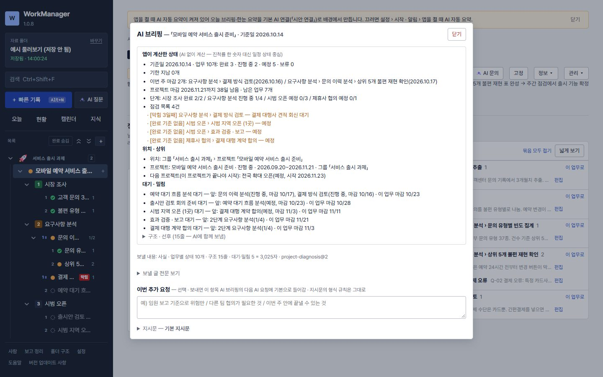

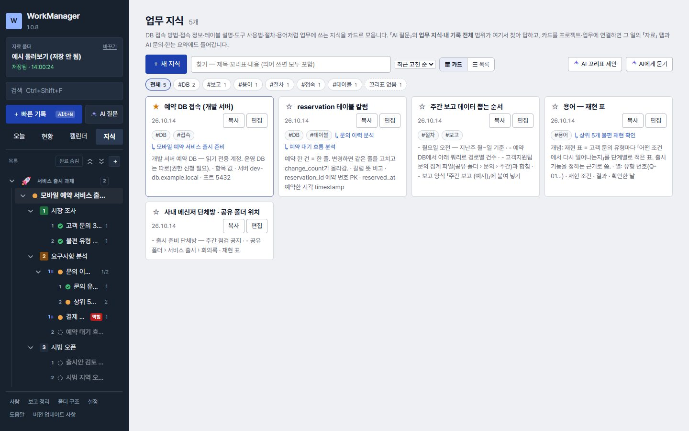

## 7. 보고 · 내보내기

기록이 곧 보고 재료입니다.

### 보고 정리

- 기간(일·주·월·직접)을 고르면 그 기간 기록을 「메일 본문」으로 바로 붙일 수 있게 모읍니다. 「AI용 원자료」는 다른 AI 도구에 넣을 글입니다.
- 산출물은 자료 폴더의 `exports`에 저장됩니다. 회사 PC의 문서 보안(DRM)이 걸리는지는 그 PC의 보안 정책에 따라 다르니 직접 확인해 주세요.

### 그림 · 글로 빼기

- 흐름도 「전체 캡처 복사 / 저장…」, 그림·Mermaid는 오른쪽 클릭으로 저장합니다.

## 8. 사람 · 틀 · 백업 · 설정

자주 쓰는 형식과 함께 일하는 사람을 한 번 정리해 두면 기록이 빨라집니다.

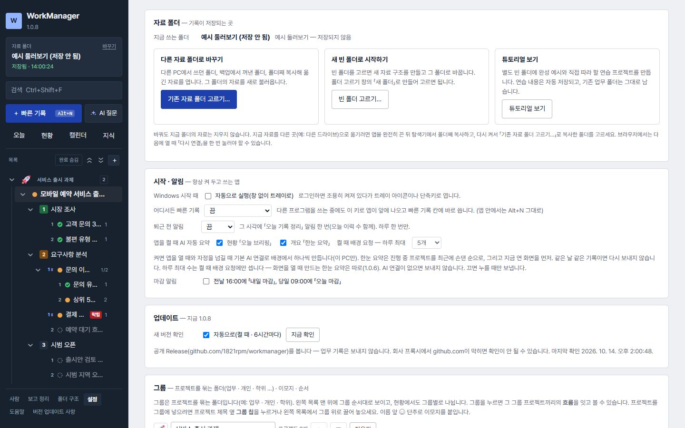

### 사람

- 업무·프로젝트의 「함께」 「요청자」에 이름을 적으면 사람 목록에 쌓입니다. 사람 화면에서 부서·역할·메모, 합치기·숨기기, 사람별 업무를 봅니다.

### 업무 틀

- 자주 하는 업무(예시: 「데이터 요청」)를 목적·체크리스트·정리 양식까지 적어 「틀로 저장」하고, 새 업무를 만들 때 「틀」에서 고릅니다.

### 백업 · 휴지통

- 설정 › 백업에서 백업 폴더(다른 드라이브 권장)와 주기를 정합니다. 「지금 백업」으로 만든 것은 지우지 않습니다.
- 지운 항목·이력은 휴지통에서 되살립니다.

## 9. 단축키

자주 쓰는 키만 모았습니다.

- **Alt+N** 빠른 기록 · **Ctrl+Enter** 기록 저장 · **Ctrl+Shift+F** 검색
- **Ctrl + / Ctrl − / Ctrl 0** 화면 확대·축소·원래대로
- **Alt+↑/↓** 체크리스트·이력 흐름 순서 옮기기 · **Esc** 넓게 보기·창 닫기
- 설정한 경우 **Ctrl+Alt+N** 등 — 다른 프로그램을 쓰는 중에도 빠른 기록
